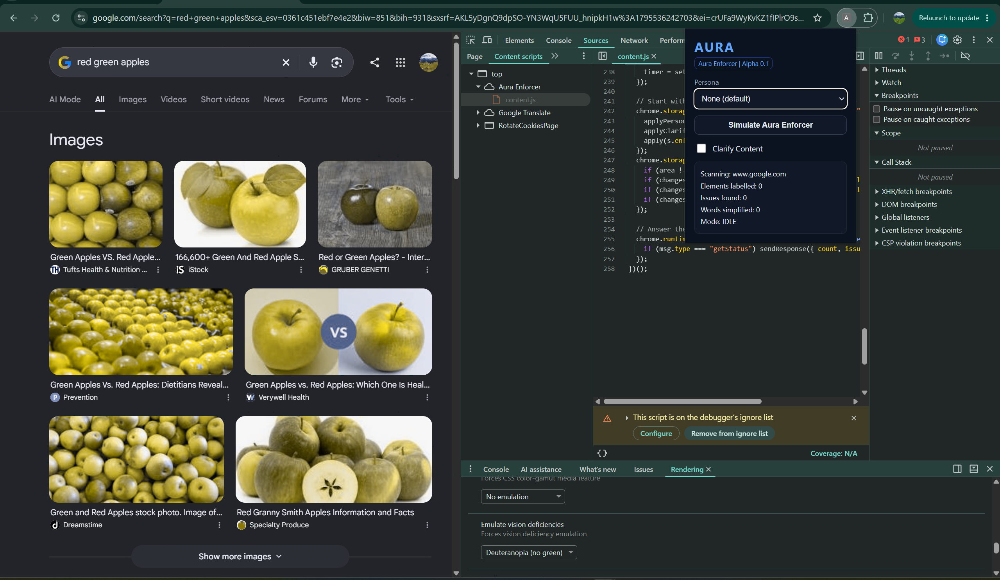
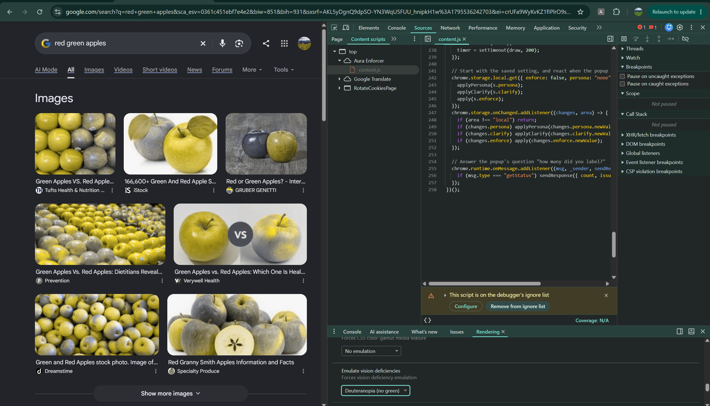
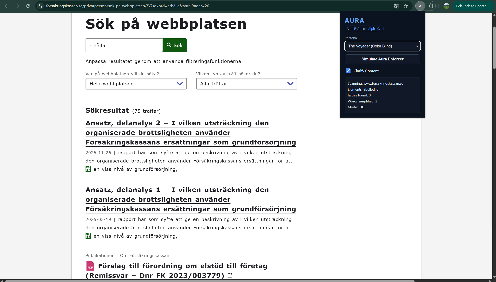

# Aura Extension – Reverse Engineering Project

# About
I got a demo video of an app called AURA and rebuilt my own version of it as a Chrome extension.

## Phase 1: Research

In the video AURA is described as an app with AI that fixes accessibility
problems. The demo shows:
- a persona dropdown (Voyager – color blind, Beacon – low vision)
- a "Simulate Aura Enforcer" button that outlines and labels everything on the page
- a "Clarify Content" toggle that makes the text simpler
- a status box that showed the same numbers the whole video

My guess was that the page loops through elements and adds outlines, and that
the personas just switch CSS classes.

I chose to build it as a Chrome extension, so it works on any website.

Tools: Chrome Extension (Manifest V3), HTML, CSS, JavaScript, VS Code, Git, GitHub, Claude.

The task mentions Lovable and V0, but they make websites, not extensions,
so I used Claude for the code instead.

## Phase 2: Implementation

Files:
- `manifest.json` – extension settings
- `popup.html` / `popup.js` – the popup with the controls
- `content.js` / `content.css` – runs on the web page and does the changes

I built it one feature at a time and tested each one in Chrome before
starting the next.

### Enforcer
Labels elements as STRUCTURE, INTERACTION, UI ELEMENT or CONTENT BOX, like in
the video. My version also does real checks: images without alt text and
buttons smaller than 24px get a red dashed box. The popup shows the number of
elements and issues on the page you're looking at. To keep big pages fast it
stops at 400 elements.

### Beacon (low vision)
Black background, yellow text, bigger text and underlined links, like in
the original. The Enforcer boxes and the popup also turn yellow.

### Voyager (color blind)
A color filter for red-green color blindness (deuteranopia, the most common
type). It moves the difference between red and green into blue, which
color-blind people can see. Grey, black and white stay the same. Links are
also underlined so they don't rely on color.

I tested it with Chrome DevTools → Rendering → Emulate vision deficiencies →
Deuteranopia, which shows the page the way a color-blind person sees it:

| Without Voyager | With Voyager |
|---|---|
|  |  |
| Red and green apples look the same | Red apples look grey-blue, green look yellow |

### Clarify Content
Switches to an easy-to-read font (Verdana) with more space between letters,
words and lines, and replaces difficult words with simpler ones. Switching it
off brings back the original text.

Some examples from the word list (about 40 English and 40 Swedish):

| Difficult | Simple |
|---|---|
| approximately | about |
| utilize | use |
| in order to | to |
| erhålla | få |
| samtliga | alla |
| i syfte att | för att |

It only changes text on the page, never what the user types in input fields.
The popup shows how many words were simplified.

On forsakringskassan.se, "för att erhålla en viss nivå" became "för att få en viss nivå":

All features can be used at the same time:

## Phase 3: Completion

I tested the extension on six different kinds of sites:

| Site | Tested | Result |
|---|---|---|
| Wikipedia (start page + article) | All features | Works |
| svt.se (news) | Beacon, Clarify, Enforcer | Works after fix |
| GitHub (my repo) | Voyager, Beacon, Clarify | Works, labels overlap a lot on dense pages |
| IKEA (shop) | Beacon, Clarify, Enforcer | Works after fix |
| vuxenutbildning.stockholm | Voyager, Clarify, Enforcer | Works, 0 issues found |
| forsakringskassan.se | Voyager, Clarify | Swedish words simplified |

Testing found two bugs that I fixed:
- Photos got a yellow tint in Beacon mode. Every Enforcer box had a light fill,
  and when boxes were nested the fills stacked up. Now the boxes are outlines only.
- On svt.se the cookie pop-up became see-through in Beacon mode, so its text
  mixed with the news text behind it. Pop-ups now keep a black background.

After testing I also improved two things:
- Voyager first only raised contrast and saturation. I replaced it with a real
  color-blind filter (an SVG color matrix) and checked it with Chrome's
  color blindness simulator.
- Clarify only had English words, so it did nothing on Swedish sites. I added
  Swedish words. I also had to change how words are matched, because the normal
  word boundary in JavaScript (`\b`) doesn't understand å, ä and ö.

## Phase 4: Problems & Solutions

- **Encoding:** Popup showed "Coming soon…". Fixed with `<meta charset="UTF-8">`.
- **Git merge conflict:** I edited the README on GitHub and on my computer at the
  same time. Fixed it with `git pull` and by cleaning up the file. Now I only
  edit locally.
- **Windows file names:** A screenshot got saved as `.png.png` because Windows
  hides file extensions.
- **Logo disappeared in Beacon:** Using Inspect I found that my CSS gave every
  container a black background that covered the image behind it. Now only the
  page background is black and the rest is transparent.
- **Too many false issues:** The Enforcer flagged almost every link in the
  article text as "Small target" (258 issues). WCAG 2.2 says links inside a
  sentence are an exception, so I skip inline links now. That brought it down
  to 19 real issues.
- **Tinted photos and see-through pop-ups:** found during testing, see Phase 3.
- **Swedish words:** `\b` treats å, ä and ö as non-letters, so it could match
  inside longer words. I switched to `\p{L}`, which knows all letters.

## Conclusion

I ended up with a working Chrome extension that has all three features from the
AURA demo. It checks each page for real accessibility problems, and the
color-blind mode is a real filter that I could test with a simulator.

What I learned:
- how a Chrome extension is built (manifest, popup, content scripts, storage)
- to use DevTools (Inspect, Rendering) instead of guessing when
  something doesn't work
- that fixing one bug can create another (the transparent background fixed the
  logo but broke pop-ups), so testing on different sites matters
- basic accessibility rules from WCAG, like target size and not relying on color

What could be better:
- Voyager only covers red-green color blindness, not other types
- Clarify uses a fixed word list; an AI model could rewrite text properly,
  like the original promised
- on dense pages the labels overlap and get hard to read
- the 400 element limit means long pages are not fully checked