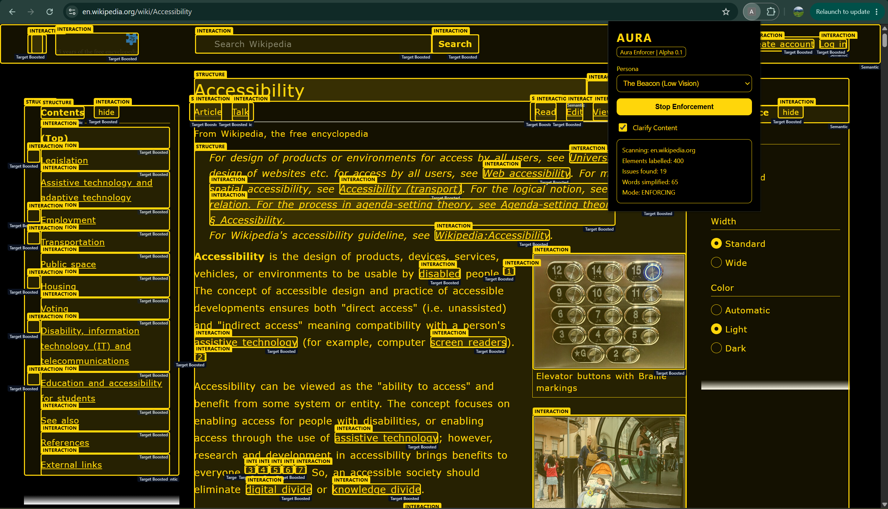

# Aura Extension – Reverse Engineering Project

APL project 2026

## About
I got a demo video of an app called AURA and had to figure out how it was
built and make my own version. I rebuilt it as a Chrome extension.

## Phase 1: Research

In the video AURA is described as a Windows app with local AI that fixes
accessibility problems. The demo itself is just a static web page with:
- a persona dropdown (Voyager – color blind, Beacon – low vision)
- a "Simulate Aura Enforcer" button that outlines and labels everything on the page
- a "Clarify Content" toggle that makes the text simpler
- a status box with numbers that never change (hard-coded)

My guess was that the page loops through elements and adds outlines, and that
the personas just switch CSS classes.

A full Windows app with AI wasn't realistic in 3.5 days, so after talking to my
supervisor I made a Chrome extension with the same idea that works on any website.

Tools: Chrome Extension (Manifest V3), HTML, CSS, JavaScript, VS Code, Git, GitHub, Claude.

The task mentions Lovable and V0, but they make websites, not extensions,
so I used Claude for the code instead.

## Phase 2: Implementation

Files:
- `manifest.json` – extension settings
- `popup.html` / `popup.js` – the popup with the controls
- `content.js` / `content.css` – runs on the web page and does the changes

I built it one feature at a time and tested each one in Chrome before
starting the next.

### Enforcer
Labels elements as STRUCTURE, INTERACTION, UI ELEMENT or CONTENT BOX, like in
the video. Unlike the original, it also does real checks: images without alt
text and buttons smaller than 24px get a red dashed box. The popup shows
the real number of elements and issues. To keep big pages fast it stops at
400 elements.

### Personas
- Beacon: black background, yellow text, bigger text, underlined links
- Voyager: more contrast and color, underlined links
- The settings are saved, so all open tabs change at the same time

### Clarify Content
Switches to an easy-to-read font (Verdana) with more space between letters,
words and lines, and replaces difficult words with simpler ones, like
"approximately" → "about". Switching it off brings back the original text.

All three features can be used at the same time:

## Phase 3: Completion

I tested the extension on five different kinds of sites:

| Site | Tested | Result |
|---|---|---|
| Wikipedia (start page + article) | All features | Works |
| svt.se (news) | Beacon, Clarify, Enforcer | Works after fix. Clarify only changes font (Swedish) |
| GitHub (my repo) | Voyager, Beacon, Clarify | Works, labels overlap a lot on dense pages |
| IKEA (shop) | Beacon, Clarify, Enforcer | Works after fix |
| vuxenutbildning.stockholm | Voyager, Clarify, Enforcer | Works, 0 issues found |

Testing found two bugs that I fixed:
- Photos got a yellow tint in Beacon mode. Every Enforcer box had a light fill,
  and when boxes were nested the fills stacked up. Now the boxes are outlines only.
- On svt.se the cookie pop-up became see-through in Beacon mode, so its text
  mixed with the news text behind it. Pop-ups now keep a black background.
  (Not retested yet, because the pop-up only shows before you accept cookies.)

## Phase 4: Problems & Solutions

- **Encoding:** Popup showed "Coming soon…". Fixed with `<meta charset="UTF-8">`.
- **Overlay didn't show up:** I first thought it was my ad blocker or site access
  settings, but in DevTools → Sources I saw that Chrome's copy of content.js was
  empty. Chrome only reloads content scripts when you reload the extension, so
  now I click ↻ after every change.
- **Git merge conflict:** I edited the README on GitHub and on my computer at the
  same time. Fixed it with `git pull` and by cleaning up the file. Now I only
  edit locally.
- **Windows file names:** A screenshot got saved as `.png.png` because Windows
  hides file extensions.
- **Logo disappeared in Beacon:** Using Inspect I found that my CSS gave every
  container a black background that covered the image behind it. Now only the
  page background is black and the rest is transparent.
- **Too many false issues:** The Enforcer flagged almost every link in the
  article text as "Small target" (258 issues). WCAG 2.2 says links inside a
  sentence are an exception, so I skip inline links now. That brought it down
  to 19 real issues.
- **Tinted photos and see-through pop-ups:** found during testing, see Phase 3.

## Conclusion

I ended up with a working Chrome extension that has all three features from the
AURA demo, and in one way it does more than the original: it finds real
accessibility problems instead of showing fake numbers.

What I learned:
- how a Chrome extension is built (manifest, popup, content scripts, storage)
- to use DevTools (Inspect, Sources, Console) instead of guessing when
  something doesn't work
- that fixing one bug can create another (the transparent background fixed the
  logo but broke pop-ups), so testing on different sites matters
- basic accessibility rules from WCAG, like target size and not relying on color

What could be better:
- Voyager is not real color-blind correction, that would need color filters
- the word list for Clarify is English only and quite short; an AI model could
  rewrite text properly, like the original promised
- on dense pages the labels overlap and get hard to read
- the 400 element limit means long pages are not fully checked