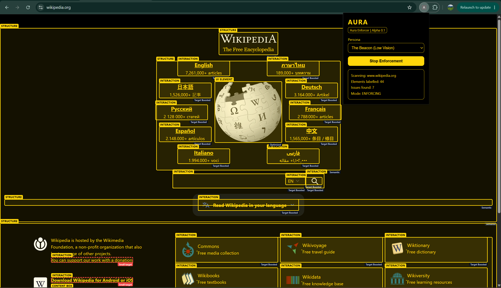

# Aura Extension – Reverse Engineering Project

APL project 2026

## About
I got a demo video of an app called AURA and had to figure out how it was
built and make my own version. I rebuilt it as a Chrome extension.

## Phase 1: Research

In the video AURA is described as a Windows app with local AI that fixes
accessibility problems. The demo itself is just a static web page with:
- a persona dropdown (Voyager – color blind, Beacon – low vision)
- a "Simulate Aura Enforcer" button that outlines and labels everything on the page
- a "Clarify Content" toggle that makes the text simpler
- a status box with numbers that never change (hard-coded)

My guess was that the page loops through elements and adds outlines, and that
the personas just switch CSS classes.

A full Windows app with AI wasn't realistic in 3.5 days, so after talking to my
supervisor I made a Chrome extension with the same idea that works on any website.

Tools: Chrome Extension (Manifest V3), HTML, CSS, JavaScript, VS Code, Git, GitHub, Claude.

The task mentions Lovable and V0, but they make websites, not extensions,
so I used Claude for the code instead.

## Phase 2: Implementation

Files:
- `manifest.json` – extension settings
- `popup.html` / `popup.js` – the popup with the controls
- `content.js` / `content.css` – runs on the web page and does the changes

### Enforcer
Labels elements as STRUCTURE, INTERACTION, UI ELEMENT or CONTENT BOX, like in
the video. Unlike the original, it also does real checks: images without alt
text and links/buttons smaller than 24px get a red dashed box. The popup shows
the real number of elements and issues. To keep big pages fast it stops at
400 elements.

### Personas
- Beacon: black background, yellow text, bigger text, underlined links
- Voyager: more contrast and color, underlined links
- The settings are saved, so all open tabs change at the same time

Voyager is not real color-blind correction. That would need color filters,
which could be a later improvement.

### Clarify Content
Switches to an easy-to-read font (Verdana) with more space between letters,
words and lines, and replaces difficult words with simpler ones, like
"approximately" → "about". Switching it off brings back the original text.
The word list is English only, so Swedish sites only get the font change.

All three features can be used at the same time:

### Problems I ran into
- Popup showed "Coming soon…". Fixed by adding `<meta charset="UTF-8">`.
- The overlay didn't show up at all. I first thought it was my ad blocker or
  site access settings, but in DevTools → Sources I saw that Chrome's copy of
  content.js was empty. Chrome only reloads content scripts when you reload
  the extension, so I have to click ↻ after every change.
- Screenshot got saved as `.png.png` because Windows hides file extensions.
- I edited the README on GitHub and on my computer at the same time, which
  gave a merge conflict. Fixed it with `git pull` and by cleaning up the file.
  Now I only edit locally.
- In Beacon mode the Wikipedia logo disappeared. Using Inspect I found that
  my CSS gave every container a black background that covered the image.
  Now only the page background is black and the rest is transparent.
- The Enforcer flagged almost every link in the article text as "Small target"
  (258 issues). WCAG 2.2 says links inside a sentence are an exception, so I
  skip inline links now. That brought it down to 19 real issues.

## Phase 3: Completion
_Coming soon_

## Phase 4: Problems & Solutions
_Coming soon_

## Conclusion
_Coming soon_