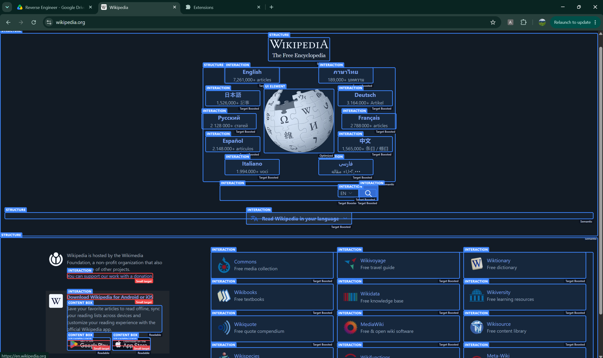

# Aura Extension – Reverse Engineering Project

APL project 2026

## Project purpose
Reverse engineer the AURA application (shown in a demo video) and rebuild
its core functionality as a Chrome browser extension.

## Phase 1: Research

### Analysing the original application
From the demo video, AURA is presented as a Windows app with local AI that
fixes accessibility problems on screen. The demo itself is a single static
web page (HTML/CSS/JS) opened locally, with:
- A persona selector: "The Voyager (Color Blind)" and "The Beacon (Low Vision)"
- A "Simulate Aura Enforcer" button that outlines and labels every element
  (STRUCTURE, INTERACTION, UI ELEMENT, CONTENT BOX)
- A "Clarify Content" toggle that rewrites text in simpler language
  and switches to a more readable font
- A status card (Scanning / Fixes Applied / Mode) with hard-coded values

### Guessed inputs
- Selected persona
- Enforcer on/off
- Clarify Content on/off

### Guessed process
1. Enforcer: loop through page elements, classify by type, add outline + label
2. Persona: add a CSS class to the page that changes colors/contrast
3. Clarify: swap text for simpler versions and change font/spacing

### Scope decision
A full Windows app with local AI is not realistic in 3.5 days. After
discussing with my supervisor, I rebuild the same idea as a Chrome
extension that works on any website.

| AURA (original)          | My extension                         |
|--------------------------|--------------------------------------|
| Top bar controls         | Popup with the same 3 controls       |
| Simulate Enforcer        | Content script labelling elements    |
| Beacon (Low Vision)      | High-contrast theme, larger text     |
| Voyager (Color Blind)    | Color-blind-friendly colors          |
| Clarify Content          | Readable font + spacing              |
| Fake status numbers      | Real site name + real fix count      |

### Tools
- Chrome Extension (Manifest V3), HTML, CSS, JavaScript
- VS Code, Git, GitHub
- GenAI: Claude

### Problems and solutions
- **Problem:** The task suggests Lovable/V0, but they build websites,
  not browser extensions.
  **Solution:** Used Claude instead, which can generate extension code.
- **Problem:** The original is a desktop app with local AI – too big for the time.
  **Solution:** Reduced scope to a browser extension with similar features.

## Phase 2: Implementation

### Setup
- Created the GitHub repo and cloned it with GitHub Desktop
- Created the extension structure: manifest.json, popup.html, popup.js,
  content.js, content.css
- Loaded the extension in Chrome via Developer mode → Load unpacked

### Project structure
| File          | Purpose                                                   |
|---------------|-----------------------------------------------------------|
| manifest.json | Extension settings (Manifest V3), permissions, scripts    |
| popup.html    | The popup UI: persona, Enforcer button, status card       |
| popup.js      | Saves the on/off setting and asks the page for its status |
| content.js    | Runs on every web page and draws the Enforcer overlay     |
| content.css   | Look of the overlay boxes and labels                      |

### Feature 1: Aura Enforcer
- The popup button saves `enforce: true/false` in `chrome.storage`,
  so every open tab reacts at the same time.
- `content.js` finds elements on the page and sorts them into four types,
  like the original:
  - **STRUCTURE** – headings, header, nav, sections, footer
  - **INTERACTION** – links, buttons, inputs
  - **UI ELEMENT** – images, icons, video
  - **CONTENT BOX** – paragraphs, lists, tables
- Each element gets an outline and a label, drawn in a separate overlay
  layer so the website's own layout is not changed and can still be clicked.
- **Real accessibility checks** (the original only showed fake numbers):
  - Images without alt text → marked red "Missing alt text"
  - Links/buttons smaller than 24px → marked red "Small target"
- The popup shows the real site name, number of labelled elements
  and number of issues found.

### Problems and solutions
- **Problem:** The popup showed "Coming soon…" instead of "Coming soon…".
  **Solution:** Added `<meta charset="UTF-8">` so Chrome reads the file
  with the right encoding.
- **Problem:** The popup updated, but the overlay never appeared on any
  website. The popup said "Not available here".
  **Debugging steps:**
  1. Checked the console – only errors from my ad blocker
     (`ERR_BLOCKED_BY_CLIENT`), not from my extension.
  2. Suspected Chrome's site access settings because the extension icon
     was grey – this was not the cause.
  3. Checked the DevTools context list – Aura Enforcer was loaded on the page.
  4. Opened DevTools → Sources → Content scripts → content.js and saw that
     Chrome's copy of the file was **empty**.

  **Solution:** Chrome reads the popup files fresh every time, but keeps a
  copy of content scripts until the extension is reloaded. Clicking ↻ on the
  extension card and refreshing the page fixed it.
  **Lesson:** After changing content.js, always reload the extension
  and refresh the page.
- **Problem:** The screenshot was saved as `enforcer-wikipedia.png.png`
  because Windows hides file extensions.
  **Solution:** Renamed the file so the README image link works.
- **Problem:** `git push` was rejected because I had edited the README
  directly on GitHub, so GitHub had a commit my local copy didn't have.
  Pulling caused a merge conflict in README.md.
  **Solution:** Pulled with `git pull --no-rebase`, resolved the conflict
  in README.md, then committed and pushed.
  **Lesson:** Edit in one place only, and always `git pull` before starting work.

## Phase 3: Completion
_Coming soon_

## Phase 4: Problems & Solutions
_Coming soon_

## Conclusion
_Coming soon_